# Drone Ship Landing

Simulated autonomous landing of a multirotor on a moving platform aboard a moving ship, without GNSS in the final design. Built to learn the ROS 2, ArduPilot and Gazebo stack end to end, with the simulation kept as close to a real system as a desktop setup allows.

**Status: early.** The drone takes off, finds a landing marker with its downward camera, flies over it and lands on it, all commanded from ROS 2 nodes. Over 30 landings from random start points it touched down a median of 1.5 cm from the pad centre, measured against the simulator's ground truth. That is on a static pad with GPS still on. In a second world the pad moves back and forth at 0.5 m/s, and the drone follows it down and lands on it: 30 of 30 landings were on the pad, with a median error of 2.1 cm. Two of them were 17 and 23 cm off, when the pad began to turn round just as the drone committed. On a circle, 30 of 30 landed with a median error of 3.1 cm. With GPS switched off and a simulated optical flow sensor in its place, both landings are as accurate as with GPS: a median of 1.2 cm on the static pad, 2.3 cm on the pad moving along a line and 3.0 cm on the circle, 30 landings each. The simulated flow sensor is an ideal one, so this shows that the landing does not depend on GPS more than it shows what a real flow sensor would do. A second way of landing therefore steers by lean angle alone, with the camera as its only horizontal reference from a hover above the pad down to it: a median of 1.3 cm on the line (30 landings, none more than 3.0 cm off) and 4.7 cm on the circle (28 landings). Those landings reached the pad without the intended pause above it; the corrected version is being measured. The ship is not implemented. See the roadmap.

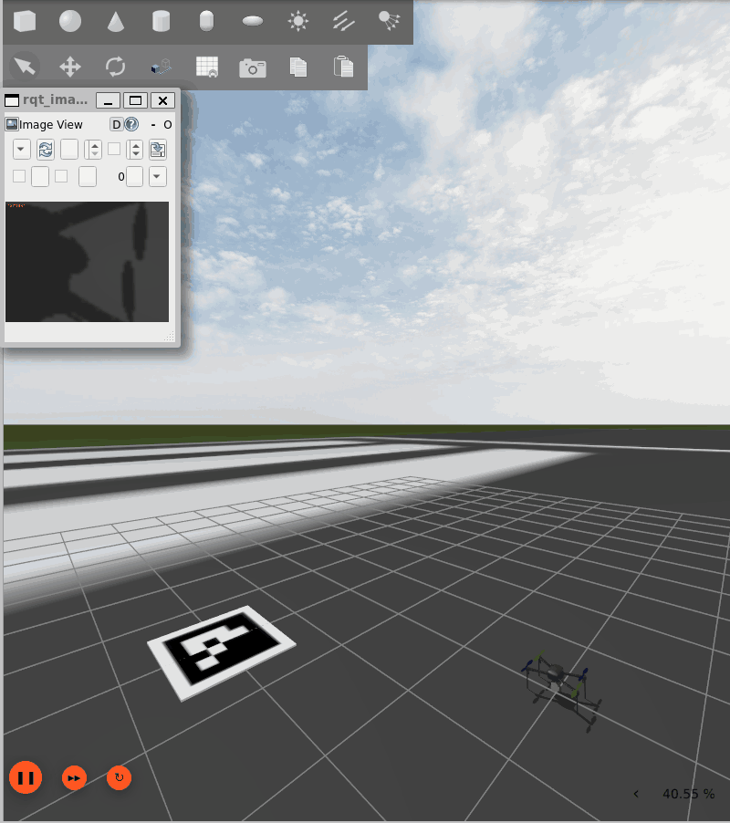

*Marker-guided landing in Gazebo, played at 2× recording speed. The simulator ran at 40 to 80% of real time, so this is close to real speed.*

## How it works

`takeoff_demo` is a ROS 2 node that talks to ArduPilot over its native DDS interface, with no MAVROS in between. It:

1. switches the autopilot to GUIDED mode,
2. arms the motors,
3. requests a takeoff to 5 m and waits until the altitude is reached,
4. publishes velocity commands for 5 s,
5. switches to LAND and exits once the drone is on the ground.

Each stage has a timeout. If the drone is airborne when a stage times out, the node commands a landing before exiting with an error.

`land_on_pad` does the same takeoff, then uses the marker to land on the pad:

1. **Search:** hover until the detector reports the marker.
2. **Align:** fly towards the pad at constant height, with speed proportional to the offset and capped at 1 m/s.
3. **Descend:** keep centring while coming down, but only while inside a cone that narrows towards the pad; outside it the descent pauses.
4. **Hand over:** below about 1 m the marker no longer fits in the image, so the autopilot's LAND mode finishes straight down.

If the marker is lost for a few seconds the drone climbs to widen its view, and if it stays lost the landing is abandoned. The decision logic is in `landing_control.py`, again without ROS, and is tested in a closed loop against a simple drone and camera model.

`land_by_leaning` (step 5d) lands on the static or the moving pad without asking the autopilot where the drone is or how fast it moves. After the usual takeoff it switches to ALT_HOLD, a mode in which the autopilot only keeps the drone level and its height steady, and steers with three stick positions sent over DDS: lean left or right, lean forward or back, and throttle. The camera closes the loop:

1. **Track:** a filter keeps the pad's position and velocity relative to the drone from the marker detections, and fills the gaps between camera frames with the acceleration the drone's own lean produces (`relative_tracking.py`).
2. **Steer:** the lean is chosen from the gap, the relative speed and the pad's estimated acceleration, limited to 10 degrees (`lean_control.py`).
3. **Descend:** the throttle stick brings the drone down while it is inside a cone that narrows towards the pad, slowing early enough to stop at 0.6 m. There it waits until it is within 5 cm and 0.10 m/s, then commits, still steering (`lean_landing.py`).
4. **Contact:** sticks level, throttle to the bottom, and a disarm request repeated until the autopilot's land detector agrees.

`marker_detector` reads the drone's downward camera, finds the pad's ArUco markers with OpenCV, and publishes the position of the pad centre relative to the camera, in metres. The pad carries two markers with the same centre: a 1 m one for flying height, and a 0.16 m one inside it that still fits in the image when the camera is too close to see the large one whole. It uses the calibration the simulated camera publishes, and it also publishes the camera image with the detection drawn on it. The detection maths lives in `pad_detection.py`, which has no ROS dependency and its own tests.

The `landing_pad` world is the ArduPilot runway with a 1.25 m pad carrying a 1.0 m marker, placed 3 m east and 2 m north of the take-off point. The `moving_pad` world has the same pad on a cart, described below. The camera is the Iris model's gimbal camera, held pointing straight down by autopilot parameters in `config/camera_down.parm`.

`levelling.py` corrects the camera's view for the drone's tilt. The camera is fixed to the body, so when the drone rolls or pitches a pad straight below appears off to one side: at 5 m height, 10 degrees of tilt moves it by almost 0.9 m. Each detection is rotated by the attitude the autopilot reported for the moment the image was taken, which gives the pad's offset in a frame that stays level. This is checked in flight (see "Numbers"). Both landings use it. The static-pad landing went without it until step 5, when a higher starting height showed that it needs it (see "Without GPS" under "Numbers").

Without GPS, the autopilot takes its horizontal velocity from an optical flow sensor and a rangefinder, both simulated by ArduPilot's SITL. `config/optical_flow.parm` switches GPS off, switches the two sensors on, tells the estimator to use flow for velocity and nothing for horizontal position, and gives it a starting location, which GPS normally supplies. The launch files load it with `nav:=flow`. Nothing in the ROS nodes changes: they still command velocities and read the autopilot's local position, which now comes from adding up flow velocity.

`nav_check` and `response_check` compare the autopilot's picture of its own motion with Gazebo's truth. The first flies a square and a hover and compares positions at each corner. The second records how the drone's true speed follows a velocity command. Both exist to answer "is the replacement for GPS as good as GPS here", and both turned out useful for ruling explanations out.

`pad_mover` drives the cart in the `moving_pad` world. The pad hangs from the world on two sliding joints, one east-west and one north-south, and each joint is driven at a commanded speed, so the joints decide where the pad is and a drone standing on it is carried along by friction. The node sends the two speeds for a path, either a line (2.5 m each way at 0.5 m/s by default, slowing down to turn round) or a circle, and reads the true joint positions back from Gazebo to stay on the path. The path generator is in `pad_motion.py`, without ROS, with its own tests.

`land_on_moving_pad` follows the moving pad and lands on it. The logic is in `pad_tracking.py`, without ROS:

1. **Estimate:** each detection is tilt-corrected and placed in the autopilot's local frame. A fixed-gain filter there tracks the pad's position, velocity and acceleration.
2. **Follow:** the drone is commanded to fly at the pad's estimated velocity plus a correction proportional to the remaining offset, with the velocity taken 0.4 s ahead to cover the drone's own lag.
3. **Descend:** it comes down while inside the same narrowing cone as on the static pad, eases off, and waits 0.30 m above the pad, with the small marker in view, for a moment when it is within 6 cm of the centre and the pad is not accelerating. A pad that never stops accelerating, on a circle for instance, is accepted after 8 s if its acceleration is at least even.
4. **Commit:** the short drop that remains is flown at 0.5 m/s without pausing. The small marker stays readable to about 0.15 m, so only the last moments get no new detections.
5. **Touch down:** on the pad it asks for the velocity it is already being carried at, so the autopilot has nothing to correct, and asks the autopilot to stop the motors. The autopilot refuses until its own landing detector is satisfied, so the motors cannot be stopped in the air by mistake.

The node then stops the pad and reads the drone's and the pad's true positions from Gazebo.

| Component | Version used |
|-----------|--------------|
| Host | Windows 10 with WSL2 |
| Linux | Ubuntu 22.04 |
| ROS 2 | Humble |
| Simulator | Gazebo Harmonic |
| Autopilot | ArduCopter SITL, 4.8.0-dev (master) |
| Ground station | Mission Planner on Windows |
| Vision | OpenCV 5.0 (ArUco module) |

## Numbers

Landing accuracy on the static pad. Each run is 3 batches of 10 landings with the simulator restarted between batches. Each landing started from a random point 1.5 to 4 m from the pad at 5 m height. The error is the distance from the pad centre to the drone's true touchdown position as reported by Gazebo, not the drone's own estimate.

There are two runs. The first showed a constant offset, the second tested an explanation for it. Both used the same 30 start points.

| | Run 1: camera assumed at the drone's centre | Run 2: camera position corrected |
|---|---|---|
| Landings attempted / completed | 30 / 30 | 30 / 30 |
| Median error | 2.2 cm | 1.5 cm |
| Mean error | 2.3 cm | 1.3 cm |
| 95th percentile | 3.0 cm | 2.1 cm |
| Worst | 3.2 cm | 2.4 cm |
| Inside the 1.0 m marker | 30 / 30 | 30 / 30 |
| Average miss | 1.4 cm west, 1.6 cm south | 0.3 cm west, 0.0 cm south |
| Batch means | 2.2, 2.3, 2.3 cm | 1.5, 1.0, 1.4 cm |
| Start point to touchdown (simulation time) | mean 17.2 s, longest 20.7 s | mean 17.4 s, longest 21.5 s |

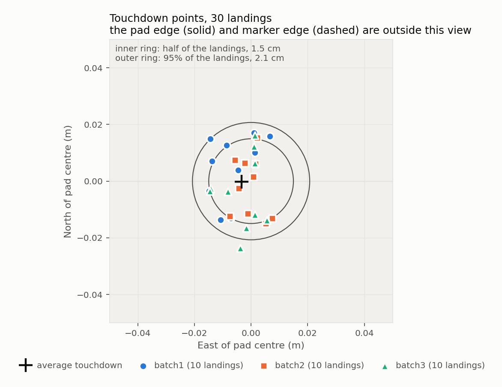

**Run 1.** Most of the error was a constant offset, not scatter: the landings clustered about 2 cm south-west of the centre, with roughly 1 cm of spread around that point. The suspected cause was that the camera does not sit at the drone's centre in the Iris model, so centring the camera over the marker leaves the body to one side.

**Run 2.** The camera's position was worked out from the model files (2.0 cm forward and 1.0 cm right of the drone's centre once it is pitched down) and added to the controller before the run. It was not fitted to the run 1 data, which would have implied 1.6 cm and 1.4 cm. The average miss fell from 2.1 cm to 0.3 cm. With about 1 cm of scatter and 30 landings, 0.3 cm is too small to tell apart from chance, so what remains is scatter around the centre.

This supports the camera-position explanation but does not prove it. The drone faced north in every landing, so an offset fixed to the drone and an offset fixed to the world, such as a pad placed slightly off its stated position, would look the same. Landings at a second heading would tell them apart.

Batch 2 of run 2 was tighter than the other two (mean 1.0 cm against 1.5 and 1.4). With ten landings per batch I would not read anything into that.

The detector's range matched the true height of the drone above the pad within 0.4% in both runs (ratio 0.996 to 1.004). The camera hangs about 0.1 m below the point Gazebo reports, so the detector actually reads about 2% long at 5 m, in line with the synthetic tests.

### Without GPS

Step 5 switched GPS off and put a simulated optical flow sensor and rangefinder in its place. The flights below are on the static pad, except the last table.

**What the autopilot does without GPS and without a replacement:**

| Test | Result |
|---|---|
| Arm on the ground | Refused: `Arm: GPS 1: Bad fix` |
| Lose GPS while hovering | `EKF3 stopped aiding`, then no reaction and about 2 cm of drift in the 31 s the flight had left |
| Whether it acts after its 30 s dead-reckoning timeout | Not settled; the one longer flight could not confirm that GPS was off |

The 2 cm is a property of the simulation, not of flying without GPS. The simulated inertial sensors are close to perfect; a real drone on inertial sensors alone drifts by metres in that time.

**Is flow as good as GPS here?** The same check flight in both setups, against Gazebo's truth:

| | With GPS | With optical flow |
|---|---|---|
| Distance the autopilot believes it flew / distance flown, four 6 m legs | 1.00 | 1.00 |
| Position error after the square and a 60 s hover | 4 cm | 6 cm |
| Drift during the 60 s hover | 1 cm | under 1 cm |
| Time to reach half of a commanded 1 m/s | 0.63 s | 0.60 to 0.66 s |
| Peak speed on that command | 1.07 to 1.08 m/s | 1.07 to 1.08 m/s |
| Distance to stop from 1 m/s | 0.61 to 0.64 m | 0.65 to 0.68 m |
| Autopilot's speed behind the true speed | 0.05 s | 0.05 s |
| True height held, target 5 m | 5.12 m | 6.32 m |

In everything but height the two are the same. The height is not an estimation error: the autopilot reports 6.33 m and holds it on purpose. Why it aims 1.2 m higher once a rangefinder is fitted is not explained (see "Known limitations").

**Landing accuracy,** 3 batches of 10 landings each, same procedure and start points as the runs above:

| | GPS, before step 5 | GPS, tilt-corrected | Optical flow, tilt-corrected |
|---|---|---|---|
| Landings attempted / completed | 30 / 30 | 30 / 30 | 30 / 30 |
| Median error | 1.5 cm | 1.3 cm | 1.2 cm |
| Mean error | 1.3 cm | 1.2 cm | 1.2 cm |
| 95th percentile | 2.1 cm | 2.1 cm | 2.5 cm |
| Worst | 2.4 cm | 2.2 cm | 2.5 cm |
| Average miss | 0.3 cm west, 0.0 cm south | 0.5 cm west, 0.3 cm north | 0.2 cm west, 0.6 cm north |
| Start point to touchdown | mean 17.4 s | mean 16.7 s | mean 19.0 s |

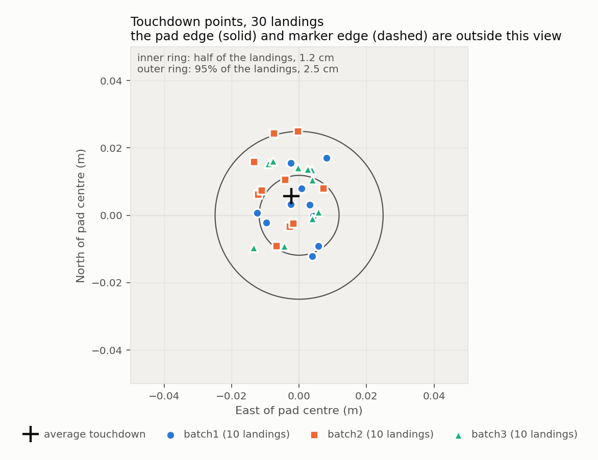

Without GPS the landing is as accurate as with it. The flow landings take about 2 s longer because they start 1.2 m higher.

What this does and does not show. The camera does the centring in both cases, and the last metre is flown by the autopilot's LAND mode, which now holds position on flow instead of GPS; the result says that hand-over still works. It does not say much about optical flow as a sensor. SITL computes the flow reading from the drone's true velocity over flat, still ground, without noise that depends on the surface, and without looking at the scene. A real flow sensor over a marker pad, a deck or water would be worse, and over a moving pad it would report speed relative to the pad.

**An instability found on the way.** The first landing without GPS reached the pad but swung back and forth over it for most of a minute first. Three explanations were tested and ruled out by measurement before the fourth held:

| Explanation | Test | Outcome |
|---|---|---|
| Flow gives a wrong speed, so the drone overshoots | Square flight against Gazebo | Ruled out: distance ratio 1.00 |
| The estimator misjudges its height, scaling the speed | Same flight | Ruled out: reported and true height agree |
| The estimate lags behind the true motion with flow | Recorded response to velocity steps | Ruled out: 0.05 s in both setups |
| The start height itself, 6.5 m instead of 5.3 m | GPS from 6.5 m; flow from 5.3 m | Held: GPS from 6.5 m swung up to 1.25 m either side; flow from 5.3 m flew straight in |

The static-pad landing did not correct for the camera tilting with the drone. A lean shifts where the pad appears, by more the higher the drone is, and the lean made to chase the pad moves the pad in the image. Below about 6 m the loop stays calm; above it, it does not. Every flight before step 5 started from 5.3 m, just under the threshold, and optical flow exposed the weakness only by making the drone climb higher. With the tilt correction from step 4b applied, the same flight from 6.5 m was 0.15 m off when it began descending and within 2 cm from there down.

A simplified model with a gentle drone did not reproduce this at any height. One shaped on the measured response (a delay, then a quick rise) did, though with the threshold nearer 8 m than 6 m, and showed the corrected landing steady from every height.

**The moving pad without GPS.** Same pad paths, speed, start points and code as the step 4e runs, with only the navigation source changed:

| | Circle, GPS | Circle, flow | Line, GPS | Line, flow |
|---|---|---|---|---|
| Landed on the pad | 30 / 30 | 30 / 30 | 30 / 30 | 30 / 30 |
| Median error | 3.1 cm | 3.0 cm | 2.1 cm | 2.3 cm |
| Mean error | 3.2 cm | 3.1 cm | 3.3 cm | 4.4 cm |
| 95th percentile | 4.7 cm | 4.5 cm | 16.6 cm | 21.0 cm |
| Worst | 5.2 cm | 5.1 cm | 22.8 cm | 21.8 cm |
| More than 15 cm off | 0 | 0 | 2 | 4 |
| Worst when the pad held its velocity | | | 4.7 cm (26 landings) | 3.5 cm (26 landings) |
| Average position along the pad's travel | 3.0 cm ahead | 2.7 cm ahead | 2.0 cm ahead | 3.4 cm ahead |
| Start point to touchdown | 28.2 s | 30.2 s | 21.8 s | 24.6 s |

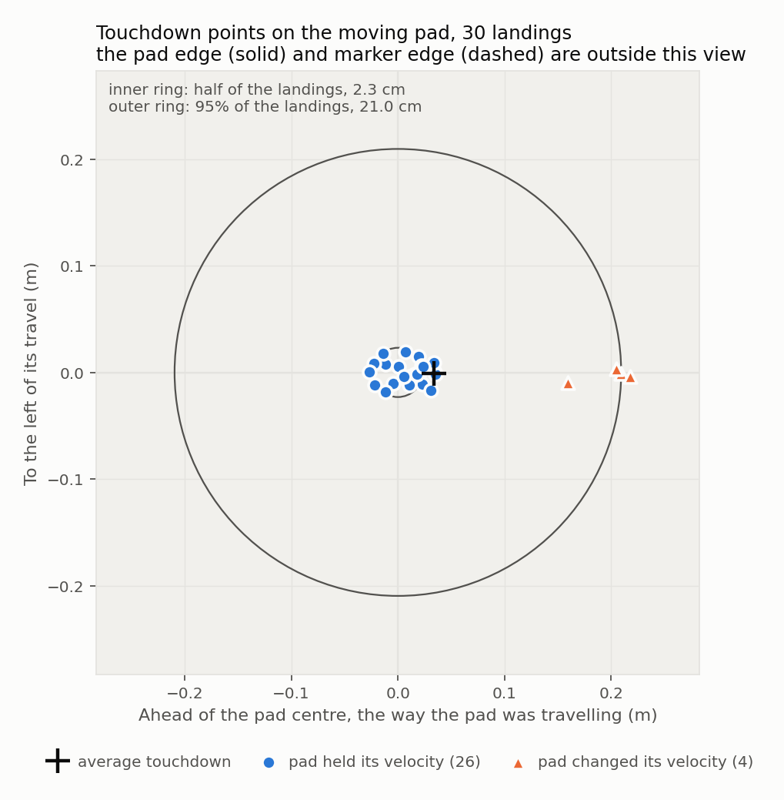

On the circle the two are the same to within a millimetre or two, including the 3 cm steady offset ahead of the centre, which therefore belongs to the landing logic and not to the navigation source. On the line, the landings where the pad held its velocity are the same too. The flow run has four landings over 15 cm against two with GPS. With 30 landings each that is not a difference: these are the landings where the pad began to brake as the drone committed, and how many of 30 start points fall into that moment is chance. Taken together it happened in 6 of 60 landings, which is more often than the 1 in 20 the model predicted in step 4e.

The flow landings take 2 to 3 s longer because the drone starts 1.2 m higher. Batch 3 of the circle run was repeated on its own, with the same start points, after the simulator stalled during it (see "Lessons learned").

As on the static pad, the caveat is the sensor. The simulated flow sensor does not see the pad moving underneath. A real one, looking down at a pad that fills more and more of its view, would report speed relative to the pad during the last metres, and the autopilot would take the pad's motion for its own. That case is not covered by these numbers.

The check flights are in `docs/response/`, the static landing runs in `docs/landing_trials/gps_levelled/` and `docs/landing_trials/flow/`, the moving-pad runs in `docs/moving_pad_trials/circle_flow/` and `docs/moving_pad_trials/line_flow/`.

### Without the autopilot's position: landing by leaning

Step 5c still leaned on the autopilot's position as a local reference, fed by a simulated flow sensor that is better than a real one (it does not see the pad). Step 5d removes that dependence for the landing itself: from the switch to ALT_HOLD down to the pad, the only horizontal reference is the marker. It was built in four parts, each checked in flight before the next.

**Sticks.** A check flight pushed each stick and compared the drone's lean with Gazebo's. Roll stick positive puts the right side down; pitch stick positive puts the nose up. The lean follows the stick as 31.6 degrees × (stick − 0.040), reaches its value in 0.24 to 0.30 s, and a throttle stick of +0.3 gives a 0.33 m/s climb.

**Tracker.** Recorded passively during ordinary moving-pad flights and compared with the truth: the relative velocity was typically 8 cm/s off and 0.05 to 0.10 s late; the relative position was within 0.3 to 3.8 cm below 2 m and 5.9 to 11.8 cm above it, where the range reads about 2% long for a pad away from the image centre.

**Holding over the pad** for 40 s from 6.4 m, one flight each, distance between the drone and the pad centre from 3 s after arriving:

| Pad | Arrived after | Median | 95% within | Worst |
|---|---|---|---|---|
| Static | 2.9 s | 2.4 cm | 4.4 cm | 5.6 cm |
| Circle, 0.5 m/s | 2.6 s | 5.3 cm | 8.6 cm | 12.7 cm |
| Line, 0.5 m/s | 3.9 s | 4.3 cm | 16.2 cm | 25.7 cm |

All three flights show the same steady offset of about 2 cm, which is 0.2 degrees from that height. Its cause is not found.

**Landing.** The same trials as step 5c: same pad paths and speed, and for each seed the same start points and waits. Flying to the start point is still done in GUIDED on the autopilot's position.

| | Circle, 5c | Circle, by leaning | Line, 5c | Line, by leaning |
|---|---|---|---|---|
| Landed on the pad | 30 / 30 | 28 / 28 | 30 / 30 | 30 / 30 |
| Median error | 3.0 cm | 4.7 cm | 2.3 cm | 1.3 cm |
| Mean error | 3.1 cm | 4.7 cm | 4.4 cm | 1.4 cm |
| 95th percentile | 4.5 cm | 5.7 cm | 21.0 cm | 2.7 cm |
| Worst | 5.1 cm | 5.7 cm | 21.8 cm | 3.0 cm |
| More than 15 cm off | 0 | 0 | 4 | 0 |
| Average position along the pad's travel | 2.7 cm ahead | 3.4 cm ahead | 3.4 cm ahead | 0.0 cm |
| Average position across it | | 3.2 cm to the outside | | 0.1 cm |
| Start point to touchdown | 30.2 s | 23.1 s | 24.6 s | 22.5 s |

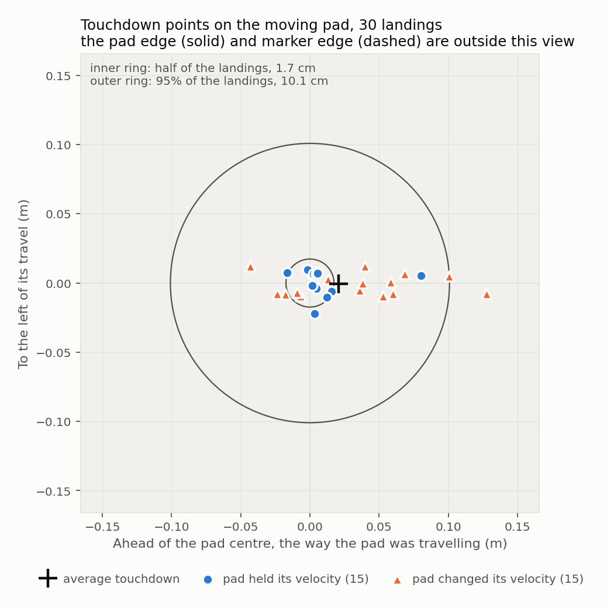

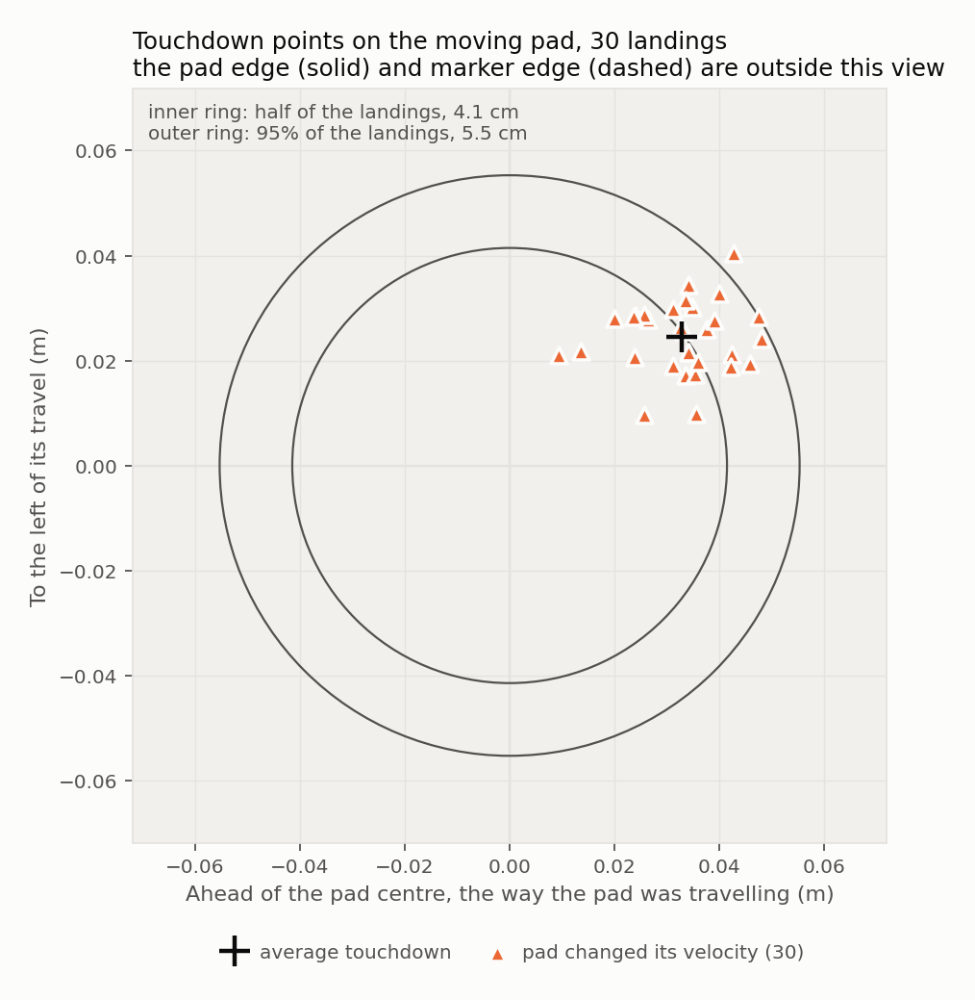

**These landings were not flown as designed.** The recordings of three of the six batches show that in 34 of 42 arrivals at the waiting height the drone did not stop there: it carried on down at about 0.5 m/s and stood on the pad before any decision to commit. In 11 of those it then lost sight of the marker, took off again from the pad and came back for a second landing. The touchdown positions in the table are true, and every landing ended on the pad, but they are the result of a steady descent straight onto the pad with steering to the end, not of the wait-and-commit described above. Two faults combined:

- The tracker's height was a smoothed average with no rate of its own, so on the way down it read 0.23 m high (median).
- In ALT_HOLD this airframe changes its climb rate slowly: stopping a 0.5 m/s descent took about 3 s, where the model had assumed a third of a second. The stick calibration had only measured a short climb.

The summaries did not show it, because a landing that reached the pad early still counted as one final descent; the per-flight recordings did. The fix replaces the height average with a filter that tracks the rate of descent (replayed on the recorded flights, its error on the way down is 1 cm in the median), plans the descent with half the braking the drone showed, treats standing on the pad as a landing whichever stage it is in, and counts such landings in the summary. **The fixed landing has run in the model and not yet in the simulator; the table above is the unfixed one.**

What these numbers do and do not show:

- **The line.** No landing was more than 3.0 cm off, against four over 15 cm in step 5c. A descent that never pauses and steers to the end leaves the pad little time to change its mind, and that is the likely reason. It is not established, and it is not the behaviour the fixed version will have: a drone that waits and then commits is exposed to the pad starting to brake during the commit, as in step 5c.
- **The circle.** Worse than step 5c by 1.7 cm in the median, and not because of noise: every landing sits in the same place, 3.4 cm ahead of the centre and 3.2 cm to the outside of the turn, with a spread under 1 cm. The model lands in the same place (4.1 cm ahead, 3.8 cm outside), so this is a property of the controller and not of the simulator. Without the pad's estimated acceleration in the lean command the model lands 8 cm outside; with it, the part the estimate is late for remains. Step 4e removed the same kind of offset with a slowly learnt correction that turns with the pad. A plain learnt correction was tried here in the model: it helped the circle and nearly tripled the line's landings over 15 cm, so it was left out.
- **28 landings, not 30.** In one circle landing the autopilot did not stop the motors within 10 s of contact and its LAND mode was asked to finish. The drone was on the pad and was measured, but a batch ends when that happens. It was one of the landings that reached the pad early; three others like it stopped their motors normally, so the cause is not established.
- **What "camera only" covers.** The horizontal steering from the switch to ALT_HOLD to the pad. Height is still the autopilot's, takeoff and the flight to the start point still use its flow-based position, and the stick map was measured on this one simulated airframe. The model still lands with a stick map 20% off, more slowly.

The runs are in `docs/lean_landing/`, the hold flights in `docs/hold/`, the stick flights in `docs/stick_check/` and the tracker recordings in `docs/relative_check/`.

### Tilt correction

A separate flight checks the tilt correction. The drone hovers 1.5 m west and 1 m south of the static pad at 5 m and swings hard east-west and then north-south, tilting up to 20 degrees. Each detection is converted to a pad position with and without the correction and compared with the pad's true offset, taken from the autopilot's position estimate. The correction is also tried with roll, pitch or both reversed, so that a misread attitude convention would show up as one of those winning.

| Conversion (RMS horizontal error) | All 308 detections | Tilted more than 4° (127) | Tilted less than 1.5° (99) |
|---|---|---|---|
| Camera as it is, tilt ignored | 0.74 m | 1.13 m | 0.10 m |
| Corrected with the attitude as published | 0.05 m | 0.06 m | 0.05 m |
| Corrected, roll reversed | 0.99 m | 1.51 m | 0.13 m |
| Corrected, pitch reversed | 0.96 m | 1.47 m | 0.11 m |
| Corrected, both reversed | 1.38 m | 2.10 m | 0.16 m |

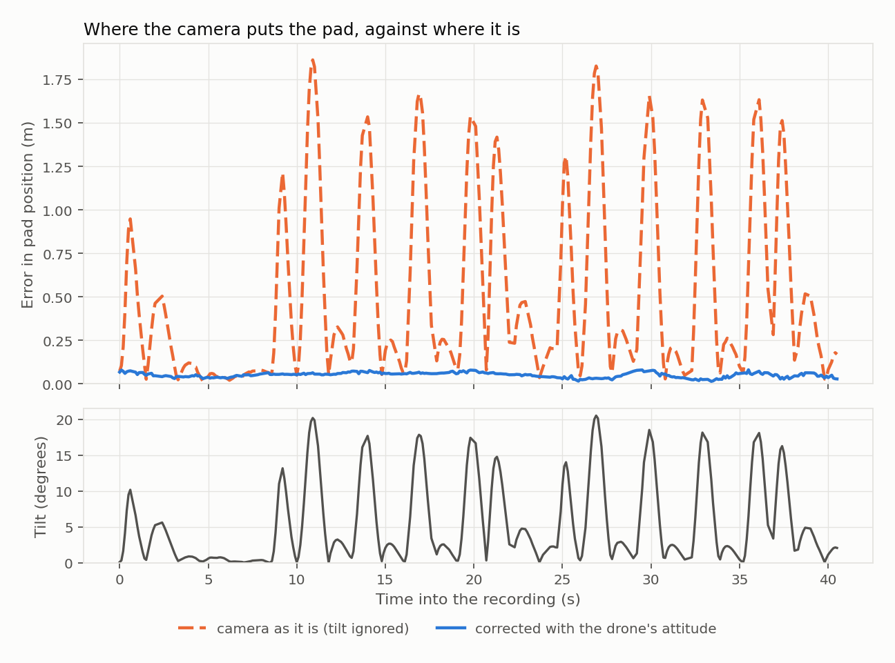

The correction as written wins clearly and every reversed variant is worse than no correction, so the attitude is being read correctly. No time offset between image and pose timestamps improved the result, and the heading implied by the camera (89.3°) agrees with the autopilot's (89.9°).

The 5 cm that remains is the same whether the drone is tilted or level, so it does not come from the correction. It is a mix of the autopilot's own position error, which this comparison cannot separate out, and the detector reading about 2% long, which is about 4 cm at the distances flown. This was one flight at one heading and one height.

### Moving pad

Landing on the pad moving back and forth along its line: 2.5 m each way at 0.5 m/s, slowing down and turning round at 0.25 m/s². Each run is 3 batches of 10 landings with the simulator restarted between batches. Each landing starts from a random point 1.5 to 4 m from the middle of the pad's path at 5 m height, after a random wait of up to 12 s so that the pad is caught at a different point of its path each time. After the motors stop, the pad is brought to rest and the drone's and the pad's true positions are read from Gazebo.

There are three runs. The first exposed a fault in the landing logic, the second tested the fix, and the third repeats the second with a fault in the trial setup removed.

| | Run 1: first version | Run 2: commit rule fixed | Run 3: trial setup fixed |
|---|---|---|---|
| Attempts | 19 | 19 | 30 |
| Landed on the pad | 17 | 17 | 30 |
| Pad not found from the start point | 2 | 2 | 0 |
| Median error | 8.8 cm | 2.4 cm | 3.0 cm |
| Mean error | 13.2 cm | 4.5 cm | 5.3 cm |
| 95th percentile | 27.6 cm | 30.3 cm | 27.6 cm |
| Worst | 27.6 cm | 30.3 cm | 28.5 cm |
| More than 15 cm off | 7 | 1 | 3 |
| Average error along the pad's travel | 12.3 cm ahead | 4.1 cm ahead | 4.1 cm ahead |
| Spread across the pad's travel | 1.0 cm | 0.8 cm | 1.0 cm |
| Start point to touchdown (simulation time) | mean 21.1 s | mean 23.8 s | mean 19.3 s, longest 25.3 s |

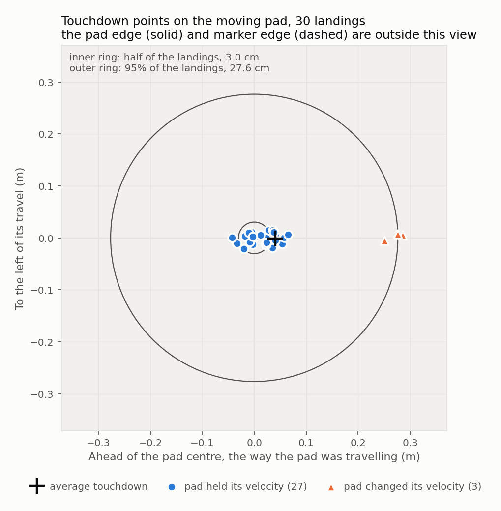

In the plot, right is ahead of the pad centre in the direction the pad was travelling at touchdown. The two groups are split by what the pad really did between the drone's commitment and touchdown, not by batch.

**Across the pad's travel the error is about 1 cm in every run.** Detection and the tilt correction are not the limit. Everything of interest happens along the direction of travel.

**Run 1** had two groups of landings: 8 within about 5 cm, and 7 between 22 and 28 cm ahead of the centre. I had predicted misses of that size from the pad changing speed during the blind last half metre, but the log showed that only 2 of the 7 were that. The other 5 followed a different pattern. While the pad turned round, the drone trailed it by up to 0.27 m and could not commit. When the turn-around ended, the drone caught up and committed at once, with the estimate still saying the pad was accelerating. The marker then went out of view, the estimate was never corrected, and the drone flew the last stretch at 0.62 to 0.68 m/s against the pad's 0.5 m/s. The waiting rule was steering commitments to the worst moment.

**Run 2** changed the rule: commit only when the pad's estimated acceleration has been near zero for 0.4 s, and fly the final stretch on velocity alone. With the same start points and seeds, none of the five turn-around cases repeated, and the landings more than 15 cm off fell from 7 to 1.

**Runs 1 and 2 shared a fault in the trial setup**, described under "Lessons learned": from the second landing of each batch, the start points were several metres from where they were meant to be, mostly 7 m east and 3 m north of the pad, at the edge of the camera's view. Two start points in each run were out of view altogether, the pad was never found, and the batch ended. The landing errors of those runs are valid measurements, but the start points were not the ones described above.

**Run 3** has the start points where they should be. All 30 landings ended on the pad. In the 27 where the pad held its velocity through the final descent, the worst error was 6.6 cm and the median 2.6 cm. In the 3 where the pad began to turn round after the drone had committed, the errors were 25 to 28.5 cm, all ahead of the centre: the drone kept the pad's earlier speed while the pad braked, and could not see it. That is 1 landing in 10, close to what the timing predicts for this path, where a turn-around begins every 12 s and the final descent takes about 1.5 s.

**On the circle** (radius 1.5 m, also 0.5 m/s, same 3 batches of 10), the picture is different:

| | Line, run 3 | Circle |
|---|---|---|
| Landed on the pad | 30 / 30 | 30 / 30 |
| Median error | 3.0 cm | 10.2 cm |
| 95th percentile | 27.6 cm | 12.5 cm |
| Worst | 28.5 cm | 12.9 cm |
| More than 15 cm off | 3 | 0 |
| Average position along the pad's travel | 4.1 cm ahead | 9.7 cm ahead |
| Average position across it | 0.1 cm right | 2.3 cm left (the outside of the turn) |
| Spread along / across | 8.1 cm / 1.0 cm | 1.2 cm / 1.1 cm |

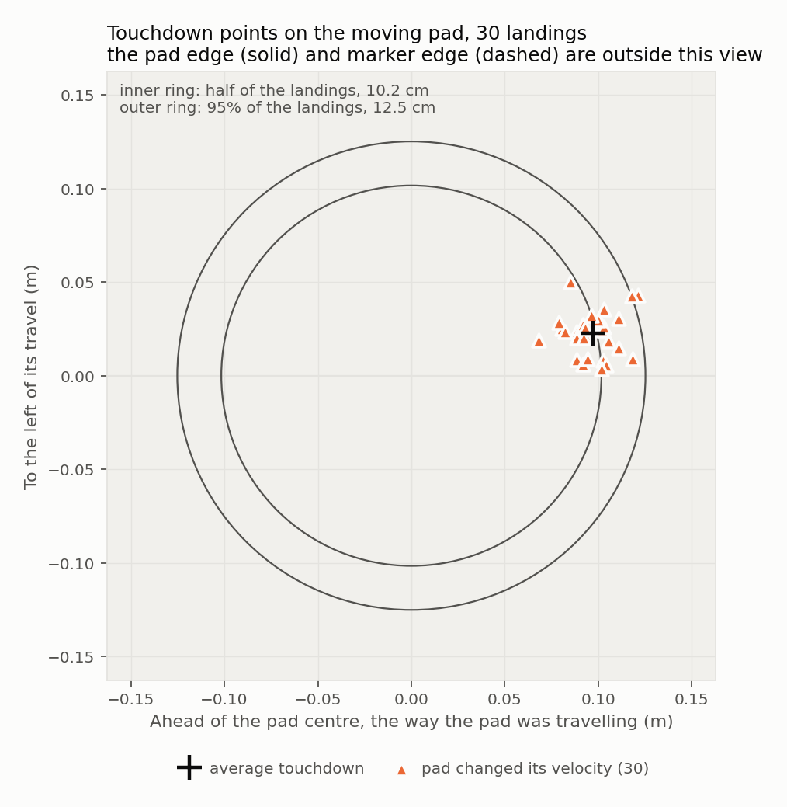

There are no large misses, because a pad on a circle never changes pace suddenly. Instead every landing is off by nearly the same amount in the same direction: the touchdown points sit in a cluster about 1 cm wide, 10 cm from the centre. I first put this down to the blind last stretch, flown on an extrapolation that does not follow the curve. That was wrong, as the next section shows.

### Moving pad, with the small marker and the revised landing logic

Step 4e added the small marker and changed the landing logic. The paths, speed and trial procedure are the same as above.

| | Line, before | Line, after | Circle, before | Circle, after |
|---|---|---|---|---|
| Landed on the pad | 30 / 30 | 30 / 30 | 30 / 30 | 30 / 30 |
| Median error | 3.0 cm | 2.1 cm | 10.2 cm | 3.1 cm |
| Mean error | 5.3 cm | 3.3 cm | 10.0 cm | 3.2 cm |
| 95th percentile | 27.6 cm | 16.6 cm | 12.5 cm | 4.7 cm |
| Worst | 28.5 cm | 22.8 cm | 12.9 cm | 5.2 cm |
| More than 15 cm off | 3 | 2 | 0 | 0 |
| Average position along the pad's travel | 4.1 cm ahead | 2.0 cm ahead | 9.7 cm ahead | 3.0 cm ahead |
| Model's prediction for "after": median / worst | | 2.0 / 22.2 cm | | 2.4 / 4.5 cm |

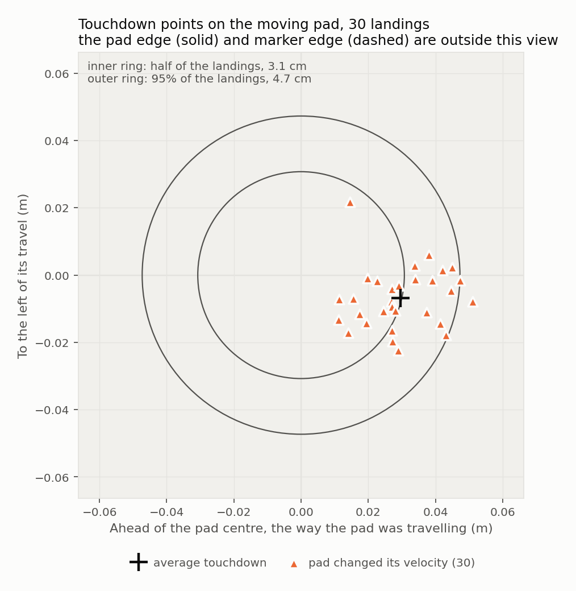

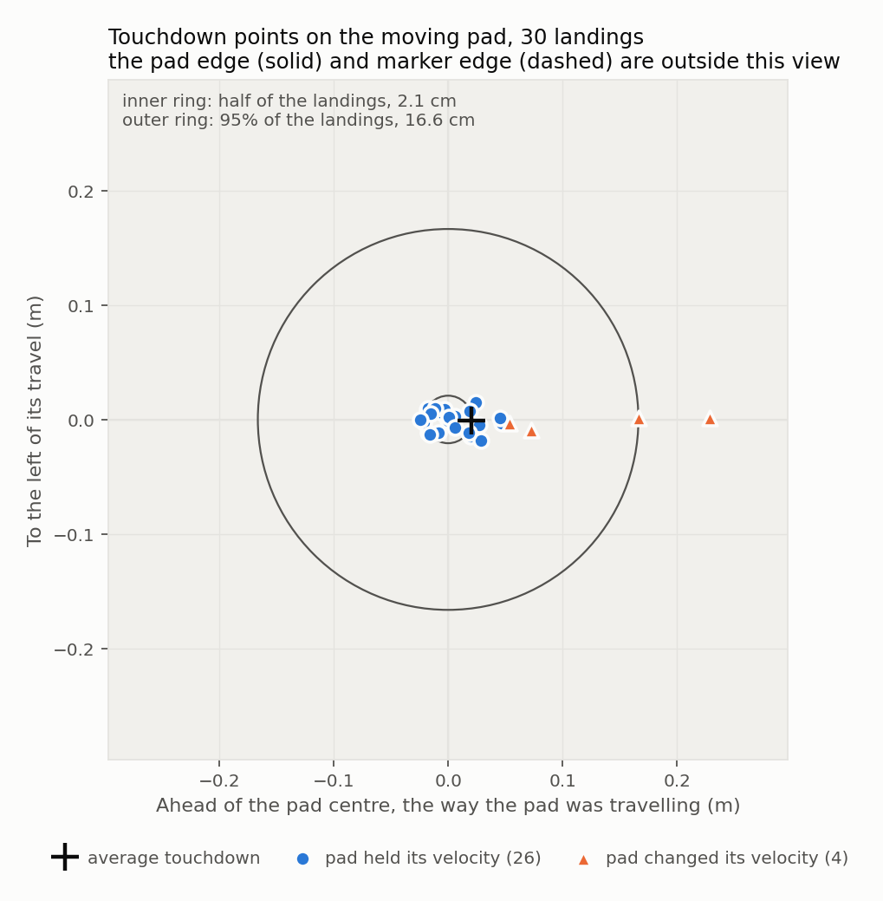

**The circle offset was a fault in the controller, not in what the drone could see.** Before changing anything, the model was run with the pad visible all the way down: the offset stayed at 9 cm. The drone was riding a fixed distance ahead of the pad throughout the descent. The controller has a slow correction for steady offsets of that kind, but it kept the correction in a fixed frame, and over a pad on a circle the offset turns with the pad, so the correction always pointed where the pad had been heading a few seconds earlier. Turning the stored correction at the pad's own turn rate brought the offset from 9.7 to 3.0 cm. The 3 cm that remain are still systematic (spread 1.1 cm) and are not explained.

**On the line, the misses are smaller and no rarer.** The drone now waits 0.30 m above the pad instead of 0.85 m, so the drop after committing takes a fraction of a second. In the 26 landings where the pad held its velocity through that drop, the worst error was 4.7 cm. In the 4 where it began to turn round, the errors were 5, 7, 17 and 23 cm. Two landings over 15 cm against three before is no difference at this sample size; what changed is the size of the worst miss, 22.8 cm against 28.5 cm. The cause that remains is the estimate, not the view: when the pad starts to brake, the filter needs about half a second to notice, and the drone commits in that time. Further adjustments in the model did not remove these cases, and I stopped there instead of tuning against the model.

The model predicted both results before the runs, including that the line misses would remain.

What none of these numbers show: two paths at one speed, the pad level, no wind, a noiseless camera, the drone facing north throughout, and GPS in use for the drone's own position. Faster pads have not been measured. The simplified model in `test/moving_pad_sim.py` predicted the blind-descent misses but not the turn-around fault of run 1, because its drone followed turn-arounds more closely than the simulated ArduCopter does. All runs are in `docs/moving_pad_trials/`.

What the static-pad landing numbers do not show: the pad was static, there was no wind, the camera was noiseless and undistorted, the drone always faced north, and the last metre was flown by the autopilot using GPS. They describe this simulation, not a real aircraft. The raw data, summaries and plots of both runs are in `docs/landing_trials/baseline/` and `docs/landing_trials/corrected/`, and the tilt check recording is in `docs/tilt_check/`.

## Design decisions

- **ArduPilot SITL as the autopilot.** SITL runs the same flight code that runs on a real flight controller, so the control loops, estimator and failsafes in simulation are the real ones. It also pairs with Mission Planner, which I wanted to learn.
- **Native DDS instead of MAVROS.** ArduPilot exposes ROS 2 topics and services directly. Fewer moving parts, at the cost of a smaller interface than MAVLink offers.
- **Simulation time everywhere.** The simulator runs slower than real time on this machine, so every node takes its clock from the simulator (`use_sim_time:=true`). Durations in the code mean simulated seconds.
- **Built as a ladder.** Each roadmap step is a working demo on its own, so the project is showable at any point rather than only at the end.
- **ArUco marker, 4x4 dictionary.** The camera is wide-angle and only 640x480, so from 5 m a 1 m marker is about 40 pixels across. A 4x4 marker has the largest cells of the standard dictionaries, which keeps it readable at that size.
- **The landing controller will live in ROS 2, not in the autopilot.** ArduPilot has built-in precision landing, but it is fed over MAVLink, which the DDS interface does not cover. A controller in ROS 2 is also what the moving platform needs later. Comparing the two is future work.
- **Velocity commands in the drone's own frame, on the static pad.** The camera is fixed relative to the drone's heading, so "the pad is 2 m ahead" turns directly into "fly forward", with no need to know which way is north. That also keeps the controller independent of GPS-derived position, which matters for the GNSS-denied step.
- **The moving pad is tracked in the autopilot's local frame instead.** To estimate the pad's velocity, the drone's own motion has to be taken out of what the camera sees, and the autopilot's position does that directly. Only differences within that frame are used, so a constant or slowly drifting position error cancels; it needs to be locally consistent, not globally right. It does use GPS today, and step 5 has to supply another source. The alternative, an integral term on the offset in the drone's frame, needs no position at all but in the model trailed behind every change of the pad's speed.
- **The pad's acceleration is estimated, not only its velocity.** A velocity-only filter always runs behind a pad that turns: in the model it missed by 0.4 m on a circle, against about 0.11 m with acceleration. The cost is more noise on a static pad (about 3 cm against 1 cm in the model).
- **Two markers, one inside the other.** The pad has no room beside the large marker, and the centre is where the drone ends up. The large marker's four middle cells form a 0.33 m square; with an ID whose middle cells are white (only 16 and 45 in this dictionary), a 0.16 m marker fits there with a white margin of its own and the large one still reads. On rendered images the pad was read in every frame from 8 m down to 0.2 m. A 0.2 m inner marker disturbed the large one more from far away and was lost sooner close up.
- **The learnt correction turns with the pad.** See the circle result under "Numbers". A steady offset relative to a moving target is steady in the target's frame, not in the world's.
- **Optical flow first, among the ways to fly without GPS.** The landing needs two things from the autopilot: to follow velocity commands, and a local position that is steady over a few seconds. Neither needs an absolute position. Flow with a rangefinder gives velocity directly, is what a small real drone would carry, and needed only a parameter file. The alternatives considered: feeding the marker's position in as external navigation, which works only while the marker is in view and reports a frame that moves with the pad; and visual-inertial odometry from the camera, which is heavy to set up and has little to hold on to over water. The first is kept as a comparison for later.
- **Lean angles, not velocity commands, for the landing without the autopilot's position.** A velocity command is only as good as the autopilot's own idea of its velocity, and near a deck a real flow sensor would measure that relative to the deck without knowing it. A lean angle needs only the attitude estimate, which does not depend on GPS or flow. The price is that the node has to do what the autopilot's position controller did: estimate relative velocity itself and turn it into lean. The alternatives considered were feeding the marker's position to the autopilot as external navigation, which reports a frame that moves with the pad and stops when the marker is lost, and ArduPilot's built-in precision landing, which is fed over MAVLink and not over DDS.
- **Sticks over DDS, in ALT_HOLD.** The DDS interface has no attitude command, but it accepts stick positions, and ALT_HOLD turns two of them into lean angles and the third into a climb rate. The map from stick to lean was measured in flight rather than read from the parameters.
- **The drone's own lean fills the gaps between camera frames.** The camera reports ten times a second, a tenth of a second late. Between frames the tracker moves the estimate on with the acceleration that follows from the drone's attitude, so a lean shows up in the estimate before the camera sees its effect.
- **Check the replacement against truth before trusting a landing with it.** Two small flights compare the autopilot's own position and speed with Gazebo's. They cost an evening and removed three wrong explanations.
- **Logic separated from ROS.** Detection (`pad_detection.py`) and the landing decisions (`landing_control.py`) are plain Python. The ROS nodes only move messages in and out, so the logic can be tested without a simulator.
- **No `cv_bridge`.** Images are converted to NumPy arrays by hand, which avoids a binary dependency that breaks when the system and pip versions of OpenCV and NumPy differ.
- **The moving pad is driven through joints, not teleported or pushed.** Setting the pad's pose repeatedly is simpler, but a drone standing on a teleported pad is not carried along. A free pad pushed by forces can drift, tip or be shoved by the landing. Speed-driven joints give an exact, repeatable path and real contact with the drone. The cost is that this pad cannot heave or tilt, so the ship in step 6 needs a different mechanism.
- **Conventions are checked in flight before they are relied on.** The tilt correction depends on what the autopilot's attitude quaternion means. Its source and comments say one thing, but a comment had already been wrong about the sideways velocity sign. So the correction came with a recording flight and an analysis that would name the wrong sign if there were one, and nothing used it until that passed.
- **Versions follow ArduPilot's documentation.** Ubuntu 22.04, ROS 2 Humble and Gazebo Harmonic are the combination the ArduPilot guides describe, chosen over newer releases to stay on the supported path.

## Lessons learned

These cost time during setup and are not obvious from the guides.

**ArduPilot build fails with a missing `config.h.in`.** A git submodule was not checked out:

```bash
cd ~/ardu_ws/src/ardupilot
git submodule update --init --recursive --force
```

**Gazebo opens but no drone appears; the log shows `Unable to find uri[package://ardupilot_gazebo/...]`.** The model search path is missing one folder. Add to `~/.bashrc`:

```bash
source ~/ardu_ws/install/setup.bash
export GZ_SIM_RESOURCE_PATH=$HOME/ardu_ws/install/ardupilot_gazebo/share:$GZ_SIM_RESOURCE_PATH
export SDF_PATH=$GZ_SIM_RESOURCE_PATH
```

**MAVProxy floods the terminal with "time moved backwards" (WSL2).** The Linux clock was jumping back by more than a second, several times a minute. Turning off the NTP service inside Ubuntu, so that Windows is the only time source, stopped it. I did not confirm the root cause beyond that.

```bash
sudo timedatectl set-ntp false
```

**Mission Planner cannot connect over UDP (WSL2 on Windows 10).** Connect with TCP to `127.0.0.1`, port `5762`.

**ROS 2 topic and service names change with a parameter.** They are `/ap/v1/...` when the autopilot parameter `DDS_USE_NS` is 1 and `/ap/...` when it is 0. Check with `ros2 service list -t | grep ap/`. After being caught by this, the nodes now look the prefix up when they start.

**The order of the autopilot's defaults files matters.** Adding my own parameter file to the end of the `--defaults` list silently changed `DDS_USE_NS` from 1 to 0, which renamed every topic. Reading ArduPilot's loader (`AP_Param.cpp`) suggests why: it re-reads the defaults later in start-up only if the last file in the list contained parameters it could not place the first time, and the DDS parameters depend on that second read. Keeping a DDS file last, as the upstream launch file does, restored the names. `param show <name>` in MAVProxy shows the value actually in use, and was what exposed this. Two earlier explanations (a start-up race, then saved parameters in `eeprom.bin`) were wrong.

**ArduPilot's body-frame velocity command has +y pointing right.** ROS convention (REP-103), and the comment in ArduPilot's own `AP_DDS_ExternalControl.cpp`, say +y is left. On the first marker-guided flight the drone closed the forward gap correctly while flying away sideways, ending 8.6 m from the pad. The detector's log made the cause obvious: one offset shrinking, the other growing. `flight_base.py` now flips the sign in one documented place.

**A node that starts before the autopilot has finished booting can arm and then be unable to take off.** In the first automated run the mode change was accepted early, arming succeeded later, and every takeoff was then refused. The likely cause is the autopilot's own start-up resetting the flight mode after the early change; this was not confirmed. The nodes now wait for the autopilot's pre-arm check, and read back the reported mode and arming state before each step, repeating the sequence if either has changed. Commanding a state and assuming it held was the mistake.

**The simulator stalled twice in long runs and the cause is not found.** Both times a measurement run went silent in mid-flight while Gazebo's window barely responded, although it still showed 70 to 80% of real time. The nodes run on simulation time, so a clock that stops reaching them stops them. The second time memory was checked and ruled out (9 GB free, no swap in use), and the simulator's log ended with routine lines. Both stalls happened with the Gazebo window open, well into a long session; the next three hour-long runs, without the window, went through. Two stalls and three clean runs suggest the window and do not establish it. A stalled batch can be repeated on its own with the same seed, which is what was done.

**Sticks sent to a topic nobody reads look exactly like centred sticks, until the mode changes.** The first stick flight published to `/joy` instead of `/ap/v1/joy`, because the base class never stored the prefix it had found. In GUIDED nothing showed. On the switch to ALT_HOLD the autopilot read the simulator's own throttle stick, which rests at the bottom, and the drone sank 4.5 m at 2.5 m/s before the node took it back. The nodes now hand over only after the autopilot's `rc` topic has shown their stick values in force for a second, and return to GUIDED at once if the height moves without being asked to.

**A summary can be right about where the drone landed and silent about how.** Thirty landings by leaning came back with a median error of 1.3 cm and one final descent each. One log line, `WAIT -> CONTACT`, did not fit: the drone was on the pad before it had decided to land. The per-flight recordings showed that most landings had gone that way. The counters had been written for the path the code was meant to take. Recording the true height next to the tracked one, and the throttle stick next to both, is what made the fault visible in minutes once someone looked.

**Starting a second simulator stops the clock for every node.** With one Gazebo already running, a second one logs `Found additional publishers on /clock, using namespaced clock topic only` and publishes its clock under another name. No simulation time reaches ROS, so nodes using `use_sim_time` wait forever, while camera images keep arriving and make everything look alive. Stop the old simulator first; `pgrep -a -f "gz sim"` shows whether one is still running.

**A one-line stop command killed itself.** The VS Code task that stops the simulator was a chain of `pkill -f <name>` commands. `pkill -f` matches whole command lines, and the task's own shell had every one of those names in its command line, so the second `pkill` ended the shell and the rest never ran. Gazebo stopped, the autopilot and the other processes did not, and "stopped" was never printed. The commands now live in `tools/stop_sim.sh`, whose command line contains none of the names, and it lists anything still running.

**A joint driven by speed commands ignores its position limits unless it has an effort limit.** Gazebo's physics engine reports this in the log. The moving pad's joints have both.

**The autopilot will not stop the motors on request while it thinks it is flying.** A disarm request over DDS is refused until ArduPilot's landing detector is satisfied. That is useful as a safeguard, but the detector does not accept a leaning drone. On the first moving-pad landing the drone, standing on the pad, was still commanded to fly at the pad's last estimated velocity. The pad turned round, the estimate could not follow because the marker was out of view, and the autopilot leaned against the pad to correct a velocity error that grew to 1 m/s. The motors ran for 10 s until the fallback. Commanding the velocity the drone already has, measured from its own position, removed the error; the motors then stopped 1.7 s after contact.

**A rule meant to pick a good moment picked the worst one.** The moving-pad landing waited above the pad until it was centred and the pad "steady", then committed. In flight, the drone was off-centre for as long as the pad was turning round, so the first moment that passed the test was just after a turn-around, when the estimate of the pad's acceleration was still out of date and about to be frozen by the blind descent. Five of seventeen landings missed by about 26 cm because of it. The test now asks for what was actually needed, no estimated acceleration, instead of a proxy for it. The closed-loop model had not shown the problem, because its drone was better at following turn-arounds than the real one.

**A plausible explanation was wrong, and a cheap check showed it.** The circle landings were all about 10 cm ahead of the centre. I blamed the blind final descent and planned the small marker as the cure. Running the model with the pad visible to the bottom, before building anything, left the offset where it was, which pointed to the controller instead. The marker was still worth adding, but it would not have fixed the circle.

**OpenCV versions treat a marker inside a marker differently.** OpenCV 4.5 reports both. OpenCV 5.0, which this machine runs, reports only the inner one once it can be read, and from 3 m the inner marker is about ten pixels wide and its position was 10 cm off. The detector now paints over the small marker and looks again whenever the large one should still fit in the image.

**Waiting close above the pad needs a gentle arrival.** With the waiting height at 0.30 m, a sluggish drone in the model overshot the height and touched the pad before committing. The descent rate now falls off with the distance still to go.

**A weakness can sit just under the conditions you always test in.** The static-pad landing was measured over 60 landings and looked finished. All of them started from 5.3 m. It turned unstable a metre higher, and nothing in those 60 landings hinted at it. The cause, the uncorrected camera tilt, was listed under "Known limitations" as something the landing "relies on low speeds" to get away with.

**Three plausible explanations in a row were wrong.** When the first landing without GPS wandered, the new sensor was the obvious suspect, and it was blamed in three different ways. Each was cheap to test against Gazebo's truth and each test said no. What remained was the one thing that differed and had nothing to do with navigation: the starting height. Changing one thing at a time, GPS at the new height and flow at the old one, settled it in two flights.

**A perfect simulated sensor makes a hard problem look solved.** Losing GPS in flight cost 2 cm of drift in half a minute, and optical flow matched GPS to the centimetre. Both say more about the simulated sensors than about flying without GPS. The numbers are reported as measured, with that caveat next to them.

**Adding a rangefinder changed what "take off to 5 m" means.** The drone climbed to 6.3 m instead of 5.3 m and held it knowingly. ArduCopter measures a GUIDED takeoff height against the terrain when a rangefinder is available, which is the likely reason, but Mission Planner showed a rangefinder reading of zero throughout and the cause is not pinned down.

**The autopilot's position is measured from home, and home moves when the motors are armed.** `pose/filtered` is relative to home, and ArduCopter resets home at every arming. The moving-pad trials re-arm on the pad, so from the second landing on, every position was measured from a different spot, and start points given in world coordinates ended up metres away. The landing itself did not care, since it only uses differences, which is why the fault survived two runs: it showed only as start points at the edge of the camera's view and two "pad was not found" failures that happened to be the two northernmost start points. The trials now tie the autopilot's frame to the world before each flight, using the drone's known position on the ground.

**Restarting the pad synchronised it with the trial.** Each trial sets the stopped pad moving again and then lands some fairly constant time later, so the pad was always at a similar point of its path at touchdown. In a rehearsal against a stand-in autopilot, all three landings fell during a turn-around. The random wait before each landing now spans a full leg of the pad's path.

**Rebuild after editing.** Even with `colcon build --symlink-install`, an edited node kept running its old code until the package was rebuilt.

**Files copied in through Windows Explorer bring `:Zone.Identifier` files with them.** They are ignored in `.gitignore` now.

**Read the first error, not the last.** When the launch failed, hundreds of lines followed, but one early line named the missing file and everything after it was a consequence.

## Build and run

Follow the official ArduPilot guides in this order. They create the workspace `~/ardu_ws` used below.

1. [ROS 2 with SITL](https://ardupilot.org/dev/docs/ros2-sitl.html)
2. [ROS 2 with Gazebo](https://ardupilot.org/dev/docs/ros2-gazebo.html)

Then clone and build this package:

```bash
cd ~/ardu_ws/src
git clone https://github.com/TeaTimeIroh/drone-ship-landing.git
cd ~/ardu_ws
colcon build --packages-select ship_landing
source install/setup.bash
```

Terminal 1, the simulator with the landing pad and the marker detector. Start it from the workspace folder, because the simulator writes its own files into the folder it is started from:

```bash
cd ~/ardu_ws
ros2 launch ship_landing pad_sim.launch.py
```

Add `view:=true` to also open the camera view with the detection drawn on it. `landing_pad.launch.py` starts the simulator alone, without the detector.

Add `nav:=flow` to fly without GPS, on simulated optical flow:

```bash
ros2 launch ship_landing pad_sim.launch.py nav:=flow
```

Values written from Mission Planner are saved by the autopilot and override the parameter files on later starts.

For the moving pad, add `world:=moving_pad`. This also starts `pad_mover`:

```bash
ros2 launch ship_landing pad_sim.launch.py world:=moving_pad
ros2 launch ship_landing pad_sim.launch.py world:=moving_pad pattern:=circle pad_speed:=1.0
ros2 param set /pad_mover speed 0.0          # change the speed while it runs; 0 stops the pad
```

To land on it:

```bash
ros2 run ship_landing land_on_moving_pad --ros-args -p use_sim_time:=true
```

After the motors stop, the node stops the pad and prints the true touchdown position from Gazebo. Restart the simulator before another landing, because the drone is then standing on the pad, not at its take-off point. `land_on_pad` is for the static pad and should not be used in this world. To only watch the detector follow the pad, hover with `ros2 run ship_landing takeoff_demo --ros-args -p use_sim_time:=true -p cruise_speed:=0.0 -p cruise_time:=60.0`.

Terminal 2, once the simulator log shows "EKF3 IMU0 is using GPS": take off and land on the pad.

```bash
ros2 run ship_landing land_on_pad --ros-args -p use_sim_time:=true
```

To check where it landed, ask Gazebo for the drone's true position; the pad centre is at x = 3, y = 2:

```bash
gz model -m iris -p
```

The simpler demo, without the camera, takes off, flies east for 5 s and lands:

```bash
ros2 run ship_landing takeoff_demo --ros-args -p use_sim_time:=true
```

Optional, for watching autopilot status: `mavproxy.py --console --map --aircraft test --master=:14550`. Add `rviz:=true` to the launch command for RViz; it is off by default because it slows the simulation.

Parameters, all optional:

| Node | Parameter | Default | Meaning |
|------|-----------|---------|---------|
| both flight nodes | `prefix` | found at start-up | Namespace of the ArduPilot DDS topics and services, for example `/ap/v1` |
| both flight nodes | `target_alt` | `5.0` | Takeoff altitude in metres |
| `takeoff_demo` | `cruise_speed` | `1.0` | Speed of the cruise leg, m/s |
| `takeoff_demo` | `cruise_time` | `5.0` | Length of the cruise leg, seconds of simulation time |
| `land_on_pad` | `gain` | `0.5` | Horizontal speed per metre of offset, 1/s |
| `land_on_pad` | `max_speed` | `1.0` | Horizontal speed limit, m/s |
| `land_on_pad` | `descent_fast`, `descent_slow` | `0.5`, `0.3` | Descent rate above and below 2 m, m/s |
| `land_on_pad` | `handover_height` | `1.0` | Height at which LAND mode takes over, m |
| `land_on_pad` | `camera_forward`, `camera_left` | `0.020`, `-0.010` | Camera position relative to the drone's centre, m |
| `land_on_moving_pad` | `gain` | `1.0` | Extra speed per metre of offset from the pad, 1/s |
| `land_on_moving_pad` | `lead_time` | `0.4` | How far ahead the pad's velocity is taken, to cover the drone's lag, s |
| `land_on_moving_pad` | `max_closing_speed` | `1.0` | Speed relative to the pad while catching up, m/s |
| `land_on_moving_pad` | `commit_height` | `0.30` | Camera height above the pad at which it waits before the final descent, m |
| `land_on_moving_pad` | `final_descent` | `0.5` | Rate of the final descent, m/s |
| `land_on_moving_pad` | `measure` | `true` | Stop the pad after landing and report the true touchdown position |
| `pad_mover` | `pattern` | `line` | Path of the pad: `line` or `circle` |
| `pad_mover` | `speed` | `0.5` | Speed along the path, m/s, 0 to 3; can be changed while running |
| `pad_mover` | `travel`, `heading` | `2.5`, `0.0` | Line: distance each way from the start point, m, and direction in degrees (0 is east-west) |
| `pad_mover` | `radius` | `1.5` | Circle: radius, m |
| `pad_mover` | `accel` | `0.25` | How quickly the pad's speed changes, m/s² |

Example: `ros2 run ship_landing land_on_pad --ros-args -p use_sim_time:=true -p target_alt:=8.0`

`marker_detector` publishes `landing_pad/pose` (`geometry_msgs/PoseStamped`, marker centre in the camera optical frame: x right in the image, y down in the image, z out of the lens) and `landing_pad/debug_image`. With the camera pointing down, image-right was the drone's right and image-up was the drone's forward direction; this was observed at one heading only. Its parameters are `image_topic`, `camera_info_topic`, `marker_size` (metres, default 1.0), `marker_id` (default 0) and `publish_debug_image`.

### Measuring landing accuracy

`landing_trials` repeats the landing from random start points 1.5 to 4 m from the pad and records, for each one, the drone's true touchdown position as reported by Gazebo. `run_trials.sh` runs several batches, restarting the simulator between batches so they are independent, then writes a summary and a plot of the touchdown points:

```bash
cd ~/ardu_ws/src/drone-ship-landing
ship_landing/tools/run_trials.sh 3 10        # 3 batches of 10 landings, about 35 minutes
```

`tilt_check` records the flight behind the tilt correction table, in the static pad world, and `analyze_tilt.py` turns the recording into a summary and a plot:

```bash
ros2 run ship_landing tilt_check --ros-args -p use_sim_time:=true -p output:=results/tilt_check
python3 ship_landing/tools/analyze_tilt.py results/tilt_check
```

Results go to `results/<date_time>/`: one CSV per batch, `summary.md` and `touchdowns.png`. The two runs reported under "Numbers" are kept in `docs/landing_trials/`. The start points depend only on the batch number, so two runs can be compared landing by landing. To re-run only the analysis: `python3 ship_landing/tools/analyze_trials.py results/<run>/batch_*.csv --out results/<run>`.

### Measuring accuracy on the moving pad

`moving_pad_trials` does the same on the moving pad. Each landing is followed by a measurement with the pad at rest, and the next one takes off from the pad. A trial that does not end with the drone standing on the pad ends its batch, since a drone left on the ground would be in the pad's way.

```bash
bash ship_landing/tools/run_moving_trials.sh 3 10              # 3 batches of 10 landings, about an hour
PATTERN=circle bash ship_landing/tools/run_moving_trials.sh    # the pad on its circle
PAD_SPEED=1.0 bash ship_landing/tools/run_moving_trials.sh     # a faster pad
NAV=flow bash ship_landing/tools/run_moving_trials.sh          # GPS off, optical flow instead
GUI=false bash ship_landing/tools/run_moving_trials.sh         # without the Gazebo window
```

Results go to `results/moving_<date_time>/`: one CSV per batch, `summary.md` and `touchdowns.png`, drawn relative to the pad's direction of travel.

The same script measures the landing by leaning, which writes its results in the same columns:

```bash
LANDER=lean NAV=flow GUI=false bash ship_landing/tools/run_moving_trials.sh 3 10
```

A single landing by leaning, with the moving pad world running without GPS:

```bash
ros2 run ship_landing land_by_leaning --ros-args -p use_sim_time:=true -p output:=results/lean_landing
```

For the static pad add `-p pad_x:=3.0 -p pad_y:=2.0`; these say where the pad starts and are used only for the truth columns of the recording. `hold_over_pad` takes the same arguments and holds over the pad for 40 s without landing.

### From VS Code

With the repository folder open in VS Code (WSL), the same commands are available as tasks: Terminal > Run Task, or Ctrl+Shift+P and "Tasks: Run Task". They are defined in `.vscode/tasks.json` and set up their own environment from `env.sh`. The start tasks refuse to run while a simulator is already up, because a second one leaves every node without a clock.

| Task | What it does |
|------|--------------|
| Sim: start static pad | Simulator, autopilot and detector |
| Sim: start static pad with camera view | The same, plus the camera view |
| Sim: start static pad without GPS (optical flow) | The same, with GPS off and optical flow on |
| Sim: start moving pad | The moving pad world with the camera view; asks for line or circle, and GPS or optical flow |
| Sim: stop everything | Stops the simulator and any leftover processes, and lists any that survive |
| Fly: land on static pad | Marker-guided landing |
| Fly: land on moving pad | Follow the moving pad, land on it, report the true touchdown position |
| Fly: takeoff demo | Take off, fly east, land |
| Fly: hover and watch | Hover at 5 m for 60 s, then land where it took off |
| Pad: set speed | Changes the moving pad's speed; 0 stops it |
| Measure: static pad quick check | Two landings with the simulator already running |
| Measure: static pad full run | Three batches of ten landings, starting its own simulator |
| Measure: static pad full run without GPS | The same on optical flow |
| Measure: moving pad quick check | Two landings on the moving pad, starting its own simulator; asks the same two things |
| Measure: moving pad full run | Three batches of ten landings on the moving pad |
| Measure: tilt check | Swinging flight near the static pad, then the tilt correction summary |
| Check: navigation against Gazebo | Flies a square and a hover, compares the autopilot's position with the truth |
| Check: response to velocity commands | Records how the true speed follows a command, then summarises it |
| Fly: hold over static / moving pad by leaning | Hold over the pad for 40 s on lean angles, camera only, then summarise |
| Fly: land on static / moving pad by leaning | Land that way and report the true touchdown position |
| Measure: landing by leaning quick check / full run | The moving-pad trials flown by leaning, on optical flow, starting their own simulator |
| Check: steering by stick positions | Pushes each stick in ALT_HOLD and reports which way the drone leans |
| Check: calibrate the sticks | Measures lean against stick position |
| Check: camera-only pad tracking | Records the relative tracker against the truth while another node flies |
| Check: where is the drone | True position from Gazebo |
| Build package | `colcon build` for this package (Ctrl+Shift+B) |
| Run tests | The pytest suite |

### Tests

The detection code is tested against synthetic camera views with a known marker position, the landing logic against a closed-loop model with camera delay, noise, dropped frames and a camera that tilts with the drone, and the pad's path generator against its travel, speed and acceleration limits, the tilt correction against a model of a drone that leans as it accelerates, and the moving-pad landing in a closed-loop model with a pad on a line or a circle, a lagging drone, late and missing camera frames and a camera that loses the marker when it is too close or too far to the side. The relative tracker, the lean controller and the landing by leaning have a second model of their own, with a lean that lags the stick, a delayed stick, and stick maps that can be made wrong on purpose. No simulator is needed:

```bash
cd ~/ardu_ws/src/drone-ship-landing/ship_landing
python3 -m pytest test/test_pad_detection.py test/test_landing_control.py test/test_ground_truth.py test/test_trial_stats.py test/test_pad_motion.py test/test_levelling.py test/test_pad_tracking.py test/test_moving_trial_stats.py test/test_relative_tracking.py test/test_lean_control.py test/test_lean_landing.py
```

These tests check the logic. They say little about real accuracy, because the drone model in them is far simpler than the simulator.

## Known limitations and roadmap

- **Runs slower than real time.** On WSL2 with an RTX 3060 the simulation runs at roughly 0.5 to 0.8 times real time. ArduPilot and Gazebo advance in lockstep, so flight behaviour is unaffected, but it makes every test slower.
- **Without GPS, both landings are measured only with the ideal simulated sensor** described in the next point.
- **The simulated optical flow sensor is ideal.** SITL computes it from the drone's true velocity over flat, still ground. It has no surface-dependent noise and does not see the pad, the deck or water. Over a moving pad a real sensor would report speed relative to the pad.
- **With the rangefinder fitted the drone climbs 1.2 m higher than asked**, to 6.3 m for a 5 m target, and the cause is not pinned down.
- **What the autopilot does about a lost GPS after its 30 s timeout is not established.**
- **One landing handed over to LAND mode at 1.45 m instead of 1.0 m** because the detector went quiet for a moment around 1.5 m. How often that happens has not been counted.
- **The camera is fixed to the body, not stabilised.** When the drone tilts to accelerate, the pad appears displaced in the image. Both landings correct for this with the drone's attitude, verified in flight. On a real aircraft the correction would also inherit the error of the attitude estimate.
- **The last metre of the static-pad landing is flown by the autopilot.** Below about 1 m LAND mode takes over and holds position on GPS or optical flow, so the final accuracy depends on that source.
- **Landing accuracy is measured only in easy conditions.** See "Numbers" for what the trials leave out.
- **The camera-position correction is checked at one heading only.** It removed a constant 2 cm offset in landings facing north. Whether it holds at other headings has not been measured.
- **Range is biased when the marker is small.** In the synthetic tests the position is good to a few centimetres within 5 m. Beyond about 8 m the marker is roughly 20 pixels wide and the range reads up to 5% long, while the direction stays within a degree. In the simulator, hovering at 5 m with the pad 3.61 m to the side, the detector reported a sideways offset of 3.67 m and found the marker in essentially every frame. The landing trials later checked range against the simulator's ground truth at 5 m; see "Numbers".
- **A pad that brakes just as the drone commits is still missed.** On the 0.5 m/s line this happened in 6 of 60 landings across the GPS and optical flow runs, 16 to 23 cm off. The filter needs about half a second to notice the pad's change of pace. Knowing the pad's path in advance would remove it; a ship's motion is not known in advance.
- **About 3 cm of steady offset remains on the circle**, ahead of the centre, unexplained.
- **A circle at 1.0 m/s never lands** in the model: the pad's acceleration is beyond what the filter tracks, and the drone waits. Not tried in the simulator.
- **The drone waits with about 0.2 m under its legs.** Gazebo here models no ground effect or rotor wash off the pad; a real drone would need more room or a different final approach.
- **The moving-pad landing is measured at one speed.** Faster pads run in the model and have not been measured in the simulator. The drone also trails a turning pad by up to 0.27 m higher up, which suggests it lags its commands more than the 0.4 s the controller allows for; that has not been tuned.
- **The velocity-command landing relies on the autopilot's position** as a local reference. The landing by leaning (step 5d) does not, from the switch to ALT_HOLD onwards; its takeoff, its flight to the start point and its height still come from the autopilot.
- **The landing by leaning stands 4.7 cm off centre on the circle**, ahead and to the outside of the turn, the same in every landing. See "Numbers".
- **The landing by leaning is measured on 30 and 28 landings at one pad speed.** That is too few to say the line's outliers are gone.
- **The stick map is measured, for one airframe.** A different drone, weight or parameter set needs the calibration flight again.
- **One landing by leaning in 58 needed LAND mode to stop the motors**, cause not established.
- **The measured landings by leaning mostly reached the pad without waiting above it**, and the corrected version is not yet measured. See "Numbers".
- **ALT_HOLD changes its climb rate slowly on this airframe** (about 3 s to stop a 0.5 m/s descent). Whether that is the simulated drone, its parameters or the mode has not been separated.
- **A steady offset of about 2 cm showed in all three hold flights from 6.4 m**, cause not found.
- **The moving pad stays level.** It slides east and north only. It cannot heave, roll or pitch.
- **The large marker is unreadable below about 0.6 m and the small one below about 0.15 m.** With the drone standing on the pad the small marker was still read, 0.09 m from the lens, but the rendered-image tests put reliable reading at 0.15 m.
- **Long runs with the Gazebo window open have stalled twice**, cause unknown. See "Lessons learned".
- **No hardware validation.** Nothing here has flown on a real vehicle. The project reduces known contributors to the sim-to-real gap; it cannot measure the gap itself.

| Step | Goal | State |
|------|------|-------|
| 1 | ArduPilot SITL, Gazebo, ROS 2 and Mission Planner running together | Done |
| 2 | ROS 2 node commanding takeoff, velocity and landing | Done |
| 3a | World with a marker pad and a downward camera | Done |
| 3b | Detector node: marker position relative to the camera | Done |
| 3c | Landing controller: centre over the marker and descend, GPS still on | Done |
| 3d | Landing error measured over repeated runs | Done |
| 4a | Pad that moves along a line or a circle, followed by the detector from a hover | Done |
| 4b | Camera measurement corrected for the drone's tilt, checked in flight | Done |
| 4c | Controller that matches the pad's speed and lands without LAND mode | Done |
| 4d | Landing error on the moving pad, measured over repeated landings (line and circle at 0.5 m/s) | Done |
| 4e | A second, smaller marker so the pad stays in view down to touchdown, and the landing logic revised to use it | Done |
| 5a | GPS switched off with nothing in its place: what the autopilot does | Done |
| 5b | Optical flow in place of GPS: checked against truth, static-pad landing measured | Done |
| 5c | Moving-pad landing without GPS, measured against step 4e | Done |
| 5d | Landing steered by lean angle with the camera as the only horizontal reference: stick check, tracker, hold, landing measured against 5c | Done |
| 6 | Ship with wave motion (heave, roll, pitch) and touchdown timing | Planned |
| 7 | Realism pass: sensor noise, latency, wind, batch runs with landing-error statistics | Planned |

## Repository layout

```
drone-ship-landing/
├── README.md
├── env.sh                            shell setup: ROS, workspace, Gazebo paths
├── .vscode/tasks.json                VS Code tasks for the common commands
└── ship_landing/                     ROS 2 Python package
    ├── package.xml
    ├── setup.py
    ├── launch/landing_pad.launch.py  simulator, autopilot and bridge in either world
    ├── launch/pad_sim.launch.py      the above plus the detector, and the pad motion if it moves
    ├── worlds/landing_pad.sdf        runway world with the static landing pad
    ├── worlds/moving_pad.sdf         runway world with the moving landing pad
    ├── models/aruco_pad/             the static pad model and its marker texture
    ├── models/moving_pad/            the pad on two sliding joints
    ├── config/camera_down.parm       autopilot parameters: camera straight down
    ├── config/optical_flow.parm      autopilot parameters: GPS off, optical flow on
    ├── tools/make_marker.py          regenerates the marker texture
    ├── tools/run_trials.sh           batches of landings with simulator restarts
    ├── tools/run_moving_trials.sh    the same on the moving pad
    ├── tools/analyze_moving_trials.py  summary and plot for the moving pad trials
    ├── tools/stop_sim.sh             stops the simulator and everything started with it
    ├── tools/analyze_tilt.py         summary and plot from a tilt check recording
    ├── tools/analyze_response.py     summary from a response check recording
    ├── tools/analyze_trials.py       summary and touchdown plot from trial CSVs
    ├── test/test_pad_detection.py    tests for the detection code
    ├── test/test_landing_control.py  closed-loop tests for the landing logic
    ├── test/test_ground_truth.py     tests for reading Gazebo's pose output
    ├── test/test_trial_stats.py      tests for the trial statistics
    ├── test/test_pad_motion.py       tests for the moving pad's path
    ├── test/test_levelling.py        tests for the tilt correction and its analysis
    ├── test/test_pad_tracking.py     tests for following and landing on the moving pad
    ├── test/moving_pad_sim.py        the closed-loop model those tests fly in
    ├── test/test_moving_trial_stats.py  tests for the moving pad trial statistics
    ├── test/test_relative_tracking.py   tests for the camera-only tracker
    ├── test/test_lean_control.py     tests for the lean controller
    ├── test/test_lean_landing.py     tests for the landing by leaning
    ├── test/lean_hold_sim.py         the closed-loop model those three fly in
    └── ship_landing/
        ├── flight_base.py            shared: connect, arm, take off, land, timeouts
        ├── takeoff_demo.py           takeoff, cruise and landing node
        ├── land_on_pad.py            takeoff and marker-guided landing node
        ├── landing_trials.py         repeated landings with ground-truth logging
        ├── ground_truth.py           true model position from Gazebo
        ├── trial_stats.py            statistics over trial results, no ROS
        ├── landing_control.py        landing decisions, no ROS
        ├── levelling.py              tilt correction of the camera's view, no ROS
        ├── tilt_check.py             flight that records data to check the tilt correction
        ├── tilt_analysis.py          analysis of that recording, no ROS
        ├── nav_check.py              flight comparing the autopilot's position with Gazebo's
        ├── response_check.py         flight recording the response to velocity commands
        ├── response_analysis.py      analysis of that recording, no ROS
        ├── marker_detector.py        camera image to marker position, ROS node
        ├── pad_detection.py          marker detection and pose estimate, no ROS
        ├── land_on_moving_pad.py     takeoff and landing on the moving pad, ROS node
        ├── pad_tracking.py           pad estimate and moving-pad landing decisions, no ROS
        ├── moving_pad_trials.py      repeated moving-pad landings with ground-truth logging
        ├── moving_trial_stats.py     statistics for those trials, no ROS
        ├── stick_base.py             shared: stick positions over DDS, and the check that they are in force
        ├── stick_check.py            flight that pushes each stick and calibrates the stick map
        ├── stick_analysis.py         analysis of that recording, no ROS
        ├── relative_tracking.py      pad position and velocity relative to the drone, camera only, no ROS
        ├── relative_check.py         records that tracker against the truth
        ├── relative_analysis.py      analysis of that recording, no ROS
        ├── lean_control.py           lean angles and stick positions to stay over the pad, no ROS
        ├── hold_over_pad.py          holds over the pad by leaning, ROS node
        ├── hold_analysis.py          analysis of a hold flight, no ROS
        ├── lean_landing.py           the way down by throttle stick, no ROS
        ├── land_by_leaning.py        landing by leaning, ROS node
        ├── lean_trials.py            repeated landings by leaning with ground-truth logging
        ├── pad_mover.py              drives the moving pad, ROS node
        ├── pad_motion.py             path of the moving pad, no ROS
        └── ap_names.py               finds the autopilot's topic prefix
```

## Credits and AI assistance

This project stands on [ArduPilot](https://ardupilot.org) (ArduCopter SITL, the DDS interface and MAVProxy), [Gazebo](https://gazebosim.org) Harmonic, [ROS 2](https://docs.ros.org) Humble, the ArduPilot Gazebo integration packages [`ardupilot_gazebo`](https://github.com/ArduPilot/ardupilot_gazebo) and [`ardupilot_gz`](https://github.com/ArduPilot/ardupilot_gz), the Micro XRCE-DDS agent, and Mission Planner, and on [OpenCV](https://opencv.org) for marker detection. The Iris quadcopter model and the runway come from those ArduPilot packages. `worlds/landing_pad.sdf` is derived from `runway.sdf` in `ardupilot_gz`, which is licensed GPL-3.0.

This is a learning project: my first time working with ROS 2, ArduPilot and Gazebo. I used it to learn how the pieces fit together and how to test a flight system step by step, not to write or study every line myself. I can explain what each part does, why it is built that way and what the measurements show; I have not gone through the code line by line.

The project was built with Claude (Anthropic) as a coding assistant. Claude proposed the staged roadmap, wrote the nodes, the launch files, the pad models, the tests and the first draft of this README, and diagnosed setup errors from the logs and screenshots I supplied, and analysed the landing trials. Several of its first diagnoses and designs were wrong and were corrected by checking against what the simulator actually did. I chose the project and its goals, installed and built the whole stack, ran every command and every flight in the simulator, and decided what to keep. The problems under "Lessons learned" were found by running each step and reading its output, and the fixes listed are the ones that worked on my machine.

## License

MIT, see [LICENSE](ship_landing/LICENSE), except `ship_landing/worlds/landing_pad.sdf`, which is derived from a GPL-3.0 file as noted above.
